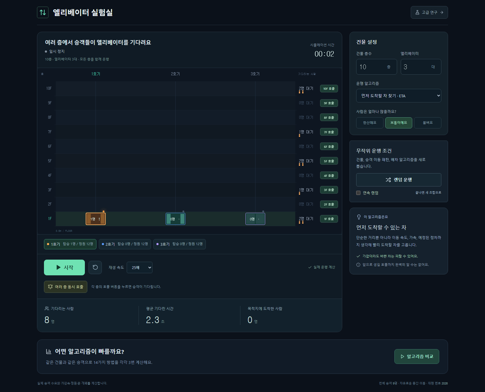

# Elevator Lab · VERTEX Rust Port

[한국어](README.md) | **English**

[VERTEX Elevator Lab](https://github.com/leekmny/vertex-elevator-lab) originally used TypeScript for its simulation and research engine. This repository **ports that engine to Rust**. The existing React interface and Electron desktop app run the Rust engine via WebAssembly, and a native Rust CLI is also available. Released under the [MIT License](LICENSE).

- The original TypeScript baseline is commit [`6b8d78b`](https://github.com/leekmny/vertex-elevator-lab/commit/6b8d78b5b21da3b5249eb9700a7fd15590d26470).
- The RECHECK comparison of Rust port commit [`d051b57`](https://github.com/leekmny/vertex-elevator-lab/commit/d051b57654dc8f85fa39f879d832bab54f6afbb3) with the original matched **22/22 scenarios**. [Verification results](docs/verification/rust-port-parity.json) · [How to reproduce the comparison](docs/RUST_PORT.md#동일-입력으로-recheck-실행)

[Architecture](docs/ARCHITECTURE.md) · [Implementation and verification status](docs/STATUS.md) · [Physics and algorithm models](docs/ENGINE.md) · [Benchmark results](docs/BENCHMARK.md) · [Changelog](CHANGELOG.md) · [Windows build and release guide](docs/GITHUB_RELEASE.md)

Run and compare elevator simulations to see how they work. Does sending the closest car always get passengers there sooner? How much does adding another elevator help? Change the building, passenger flow, and operating policies. The simulation accounts for acceleration, deceleration, door operation, and car capacity.

## Running the Rust port

The `main` branch contains the Rust port. Install Node.js and Rust 1.96 or later, and run `rustup target add wasm32-unknown-unknown`. If Cargo is unavailable locally, you can build with Docker Desktop running Linux containers.

```sh
npm ci
npm run dev
```

Open the URL printed in the terminal in your browser. To launch the Windows desktop app directly, run `npm run desktop`. See [the Rust CLI and RECHECK reproduction guide](docs/RUST_PORT.md).

## Download for Windows

**[Download the original TypeScript Windows release](https://github.com/leekmny/vertex-elevator-lab/releases/tag/v1.0.0)**

Download **`VERTEX-Windows.zip`** under **Releases → Assets** in the original repository. To package the Rust port as a Windows executable, follow the [Windows build guide](docs/DESKTOP.md#개발자가-다시-빌드하기) and run `npm run package:win` in this repository.

1. **Extract the entire ZIP archive** into a folder.
2. Double-click **`VERTEX.exe`** in the `VERTEX-Windows` folder.
3. The animation starts as soon as the window opens.

This is a **portable Windows x64 application**. The target PC can run it without internet access, Node.js, npm, a development server, or a separate browser. Keep `resources`, `locales`, and the DLLs alongside the executable. Close the window with the X button to exit.

This build is unsigned. Windows may report that it cannot verify the publisher. To check download integrity, compare the ZIP's SHA-256 hash with `SHA256SUMS.txt` from the same release. See the [Windows executable guide](docs/DESKTOP.md) and [GitHub release guide](docs/GITHUB_RELEASE.md) for the steps.



## Experiments to try

- **Same building, different algorithm**. Keep the building and passenger settings fixed, run a comparison, and look at wait times alongside the number of passengers who have yet to arrive.
- **Watch randomized runs**. See what happens as the building, fleet, and passenger flow change. Continuous random mode cycles through different combinations.
- **Call elevators from several floors**. Press the floor call buttons and watch which car each passenger boards. Look for the orange occupancy lights and capacity displays.

## Using the basic view

- **Floors / Cars**. Enter a number, then press Enter or click away to apply it. The ranges are 5–100 floors and 1–20 cars. Invalid input reverts to the previous value.
- **Pause / Start**. Pause or resume the animation.
- **Random run (랜덤 운행)**. Generate a new combination of building size, cars, demand pattern, operating policy, and dispatch algorithm. This mode does not necessarily generate high passenger demand.
- **Continuous random mode (연속 랜덤)**. Start another randomized run automatically when an experiment ends.
- **Floor calls / Simultaneous floor calls**. Use the buttons next to the building to place a call from one floor or generate new passengers on several floors at once. Each car displays `occupancy / capacity`, and its orange light turns on when it carries passengers.
- **Playback speed**. Watch at speeds from 0.25× to 1,000×. The same passenger, movement, and capacity rules apply at every speed.
- **Algorithm**. Select an algorithm to see how it works and what its trade-offs are in the description below.
- **Algorithm comparison**. Run 14 algorithms against the same initial settings and passenger traces from three seeds, for a total of 42 runs. The comparison displays means, variation across runs, and counts of passengers who did not finish. Calls added manually in the interface are excluded.
- **Advanced research (고급 연구)**. Open the detailed settings, algorithm comparisons, repeated experiments, charts, and export tools.

If passengers remain at the end of the observation period, the interface shows **관찰 종료** (Observation ended) and keeps their journeys incomplete.

You can reproduce randomized runs with their seed and settings. Cars move continuously, and the displayed statistics reflect the simulated runs.

## Running from source

Node.js 22.12 or later is recommended. The documented installation used Node.js 26.13.1 and npm 11.20.0.

```powershell
npm ci
npm run dev
```

Open the local URL printed in the terminal (`http://127.0.0.1:5173` by default). The app runs without a separate API server, account, or cloud key.

```powershell
npm run build       # Build Rust WebAssembly, type-check, and generate static deployment files
npm test            # Check physics, the engine, invariants, and research statistics
npx playwright install chromium
npm run test:e2e    # Check browser settings, playback, exports, and research mode
npm run benchmark  # Run repeated experiments and write measurement results
```

`npm run dev` opens the app in a browser for development. Users can open the packaged EXE directly. Run `npm run package:win` to build a new Windows package or `npm run desktop` to build and open the desktop window. Use `dist/` for web deployment and the EXE package for local desktop use.

## Using the advanced research view

1. In Live mode, choose the number of floors and cars, an algorithm, and an operating policy.
2. A traffic intensity of 100% represents the building-wide baseline arrival rate in **passengers per minute**. The simulation distributes it across origin floors according to floor weights and population shares.
3. Select **Start** to watch the simulation. Use **Pause**, **Single event (한 이벤트)**, and **Reset (초기화)** to inspect event processing. The playback speed changes only how much simulation time the interface requests.
4. In Research mode, set the ranges for cars, floors, and traffic intensity, and choose the number of seed repetitions. Each repetition reuses the same demand trace for every algorithm.
5. Review mean and P95 waiting times, the number of incomplete journeys, remaining queues, and current wait times. For saturated scenarios, also consider passengers whose journeys are still incomplete when assessing a policy.

## Project structure

```text
rust/                 # Rust simulation and research engine, native CLI, and tests
src/
  sim/                # Original TypeScript simulation and shared formats
    types.ts          # Shared configuration, passenger, car, and metric contracts
    config.ts         # Defaults and validation of physics and service settings
    physics.ts        # Triangular and trapezoidal speed profiles, continuous position
    demand.ts         # Seeded randomness, passenger generation, and demand trace hashes
    algorithms.ts     # Dispatch and stop order policies, with algorithm descriptions
    engine.ts         # Event queue, car state transitions, routing, capacity, and metrics
  workers/
    live.worker.ts    # Live comparison sessions with identical demand
    research.worker.ts # Worker for repeated experiments
  research/
    statistics.ts     # Standard deviation, Student's t intervals, and paired comparisons
    runner.ts         # Parameter sweeps and fleet-sizing analysis
    export.ts         # CSV, JSON, and standalone HTML reports
  components/
    Building.tsx      # Canvas display of continuous car positions and floor queues
    Chart.tsx         # Apache ECharts visualizations
    ResearchMode.tsx  # Settings and results for repeated experiments
tests/                # Vitest and Playwright regression tests
scripts/benchmark.ts  # Reproducible performance measurements
docs/                 # Model, algorithm, and experiment definitions and results
```

## Comparing and interpreting results

- **Separate demand and operational randomness**. Passenger demand traces are generated before a run. Given the same seed and demand settings, every algorithm receives the same departure times and origin–destination pairs. The results include the demand hash.
- **Information available to dispatch algorithms**. Conventional hall calls provide the origin floor and travel direction. Only destination dispatch uses a passenger's destination before boarding. Take that difference into account when comparing their results.
- **Statistics**. The engine calculates means, sample standard deviations, and 95% Student's t confidence intervals across runs. Confidence intervals require more than one repetition. JSON output represents non-finite values as `null`.
- **Passengers included in averages**. See the [engine documentation](docs/ENGINE.md) for the definitions of waiting and travel metrics and the [research documentation](docs/RESEARCH.md) for repeated experiments and fleet-sizing analysis. Reports include the number of incomplete journeys. At the end of a run, those passengers remain in the simulation state with their journeys still marked incomplete.
- **Fleet-sizing estimates**. The minimum number of cars for a target waiting time applies only to the conditions tested and cannot replace statutory design, handling-capacity certification, or manufacturer performance guarantees for actual buildings.
- **Energy**. The displayed kWh is an estimate from a simplified model of travel and stops. The model uses no measured power data or detailed calculations of regenerative braking, counterweights, or motor efficiency.

## Reproducible example

The defaults are 20 floors above ground, two cars, 12 passengers per car, a top speed of 2.5 m/s, acceleration of 1 m/s², a floor height of 3.5 m, a 600-second observation period, seed 2026, a baseline of 24 passengers per minute, and 100% traffic intensity.

In Research mode, set the building to 20 floors, the fleet range to 1–6 cars, traffic intensity to 100%, and the number of repetitions to at least three. Run the same set of algorithms. For overload comparisons, use the sustained-overload scenario or a high baseline arrival rate. Record whether the run continued serving remaining passengers (Drain) and its maximum drain duration alongside the results.

The [Rust CLI](docs/RUST_PORT.md#동일-입력으로-recheck-실행) can run the engine without the interface. This example runs the original TypeScript engine for comparison.

```typescript
import { defaultConfig } from './src/sim/config';
import { generateDemand } from './src/sim/demand';
import { Simulation } from './src/sim/engine';

const config = { ...defaultConfig(), cars: 4, seed: 2026 };
const demand = generateDemand(config);
const look = new Simulation(config, 'look', demand).run();
const eta = new Simulation(config, 'eta', demand).run();
console.log(look.demandHash === eta.demandHash, look.metrics, eta.metrics);
```

## Dependency versions

`package-lock.json` pins the installed versions. The documented installation confirmed React 19.3.1, Vite 8.3.8, Tailwind CSS 4.3.5, ECharts 6.1.0, Vitest 5.1.0, and Playwright 1.65.1. The setup follows the [official Vite guide](https://vite.dev/guide/) for Node.js requirements, [Tailwind's Vite installation guide](https://tailwindcss.com/docs/installation/using-vite) for Tailwind integration, and the [official ECharts import guide](https://echarts.apache.org/handbook/en/basics/import/) for ECharts configuration.

## Verification results and scope

Automated checks cover physics calculations, a hand-verified single journey, fleets of 1, 2, 3, 4, 8, 12, and 20 cars, buildings of 5, 20, 50, and 100 floors, 0% and 500% demand, passenger conservation under overload, transfers for every origin–destination pair, heterogeneous fleets, Drain for every algorithm, reproducibility, independence from snapshot frequency, statistics, and exports. They also check that single-event and batch stepping agree at event completion boundaries, and that comparison sessions can finish when algorithms finish draining at different times.

The table below records verification of the original TypeScript version on 2026-11-18. For the Rust port, see [RECHECK and additional checks](docs/verification/rust-port-parity.json).

| Command | Result |
|---|---|
| `npm test` | **100 tests passed** across 17 files |
| `npm run test:e2e` | **18 Chromium integration tests passed** |
| `npm run build` | TypeScript checks and the Vite production build succeeded |
| `npm run benchmark` | Produced 78 fleet-sizing and saturation experiment runs and nine performance measurements |
| `npm run package:win` | Produced the Windows x64 EXE folder and ZIP, and verified that all 76 files in the ZIP matched |
| `npm run test:desktop` | Verified offline calls, boarding, and comparison of 14 algorithms in the actual EXE. Recorded zero errors, HTTP requests, and TCP listeners during normal operation. |

Integration tests checked that single and simultaneous floor calls add actual passengers, that orange occupancy lights work, and that continuous random mode works at 1,000×. They also covered button spacing with 100 floors and 20 cars, actual comparisons of 14 algorithms with insufficient samples excluded from rankings, settings changes, playback controls and reset, comparisons at identical demand and times, JSON settings round-trips and passenger conservation, completion of Drain comparisons, downloadable chart PNGs and research CSVs, and mobile-width layouts. The live, comparison, and research views and the 390 px mobile view were rendered and visually inspected. The capture reported zero browser runtime errors. The advanced research view loads on demand. Its JavaScript chunk includes ECharts and exceeds the 500 kB warning threshold, which adds loading time the first time the view opens.

Screenshots include the [basic desktop view](docs/screenshots/simple-desktop.png), [basic mobile view](docs/screenshots/simple-mobile.png), [advanced live view](docs/screenshots/live-desktop.png), [algorithm comparison](docs/screenshots/comparison-desktop.png), and [research results](docs/screenshots/research-desktop.png). During development, you can regenerate them with `node scripts/capture-preview.mjs` while the local server is running.

The [benchmark summary](docs/BENCHMARK.md) and [benchmark.json](docs/benchmark.json) record actual measurements with the execution environment, runtimes, and passenger conservation results. You can reproduce the [example configuration](examples/scaling-config.json), [full results](examples/scaling-result.json), and [standalone HTML report](examples/scaling-report.html) with the same seed and dependency versions.

The model and interface have the following limitations.

- ETA and full-journey costs use documented approximations. Commercial manufacturers' proprietary group-control policies are outside the scope of the model.
- Genetic algorithms (GA) and simulated annealing (SA) perform real searches with a small, finite budget and offer no guarantee of a global optimum. The simulation includes no trained reinforcement learning policy.
- Time-varying demand uses the provided piecewise patterns and floor weights. The app supports those patterns and weights, with no arbitrary time-function editor or predictive model trained on real building data.
- Saturation charts show results for a finite observation window. The app provides neither a mathematical guarantee of maximum sustainable throughput nor an automated search for the saturation boundary under continuous demand. Differences in the observed completion rate do not measure spare capacity.
- A fault safely retires a car so that riders can exit normally. Sudden mechanical stops, rescue, walking, and emergency evacuation are outside the model. Passengers remain incomplete if retirement of the last car that serves them makes service impossible.
- Floor-to-floor service imbalance uses the coefficient of variation of mean wait times on served floors. Check queues on unserved floors as well. Travel distance and energy use simplified models.
- To revisit a run, the app recomputes it from the settings and seed. General event recording for all user actions, such as manually retiring a car, is outside the scope of the app.
- The interface defaults to Korean. The English toggle covers primary navigation and actions, with some detailed help and research settings still in Korean.
- For tall buildings, select the range of floors to display. The view has no continuous zoom or building-type demand presets validated against field measurements.
