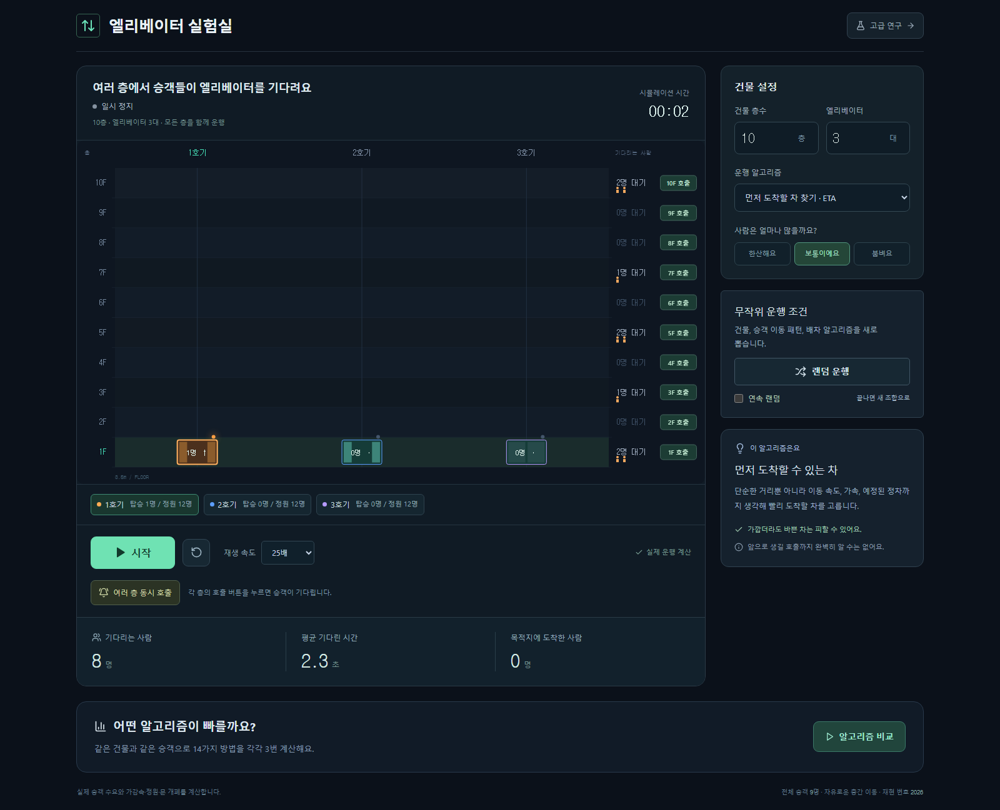

# 엘리베이터 실험실 · VERTEX Rust 포트

[VERTEX 엘리베이터 실험실](https://github.com/leekmny/vertex-elevator-lab)의 시뮬레이션 및 연구 엔진을 **TypeScript에서 Rust로 포팅**한 저장소입니다. 기존 React 화면과 Electron에서 Rust 엔진을 WebAssembly로 실행하며, Rust 네이티브 CLI도 제공합니다. [MIT License](LICENSE)로 공개합니다.

- 원본 TypeScript 기준 커밋은 [`6b8d78b`](https://github.com/leekmny/vertex-elevator-lab/commit/6b8d78b5b21da3b5249eb9700a7fd15590d26470)입니다.
- Rust 포팅 커밋 [`d051b57`](https://github.com/leekmny/vertex-elevator-lab/commit/d051b57654dc8f85fa39f879d832bab54f6afbb3)을 원본과 비교한 RECHECK에서 **22/22 시나리오**가 일치했습니다. [검증 결과](docs/verification/rust-port-parity.json) · [재현 방법](docs/RUST_PORT.md#동일-입력으로-recheck-실행)

[아키텍처](docs/ARCHITECTURE.md) · [구현 범위와 검증 상태](docs/STATUS.md) · [물리·알고리즘 모델](docs/ENGINE.md) · [실제 벤치마크](docs/BENCHMARK.md) · [변경 기록](CHANGELOG.md) · [Windows 빌드·배포 안내](docs/GITHUB_RELEASE.md)

직접 움직여 보고, 비교하며 배우는 엘리베이터 실험실입니다. “가까운 차를 보내면 항상 빠를까?”, “엘리베이터를 한 대 더 늘리면 얼마나 달라질까?” 같은 궁금증을 눈으로 확인해 보세요. 건물과 승객 흐름, 운행 방식을 바꾸며 가감속·문 개폐·정원까지 계산한 움직임을 관찰할 수 있습니다.

## Rust 포팅판 실행

이 저장소의 `main`에는 Rust 포트가 있습니다. Node.js와 Rust 1.96 이상 및
`rustup target add wasm32-unknown-unknown`을 준비하세요. 로컬 Cargo가
없으면 Linux 컨테이너가 켜진 Docker Desktop으로도 빌드할 수 있습니다.

```sh
npm ci
npm run dev
```

터미널에 표시된 주소를 브라우저에서 여세요. Windows 데스크톱에서 직접
실행하려면 `npm run desktop`을 사용하세요. [Rust CLI 및 RECHECK 비교 재현](docs/RUST_PORT.md)

## Windows 다운로드

**[원본 TypeScript판 Windows 배포본 받기](https://github.com/leekmny/vertex-elevator-lab/releases/tag/v1.0.0)**

원본 저장소의 **Releases → Assets**에서 **`VERTEX-Windows.zip`**을 내려받으세요. Rust 포팅판을 Windows 실행 파일로 만들려면 이 저장소에서 [Windows 빌드 안내](docs/DESKTOP.md#개발자가-다시-빌드하기)를 따라 `npm run package:win`을 실행하세요.

1. ZIP을 **폴더 전체로 압축 해제**합니다.
2. `VERTEX-Windows` 폴더 안의 **`VERTEX.exe`**를 더블클릭합니다.
3. 프로그램 창이 열리면 애니메이션이 바로 시작됩니다.

**Windows x64 포터블 프로그램**입니다. 받는 PC에는 인터넷·Node.js·npm·개발 서버·별도 브라우저 설치가 필요하지 않습니다. EXE 옆의 `resources`·`locales`·DLL도 실행에 필요하므로 **EXE만 따로 옮기지 마세요**. 종료는 창의 X 버튼입니다.

이 빌드는 코드 서명되지 않았습니다. Windows에서 게시자를 확인할 수 없다는 안내가 표시될 수 있습니다. 다운로드 무결성을 확인하려면 같은 릴리스의 `SHA256SUMS.txt`와 ZIP의 SHA256을 비교하세요. 자세한 순서는 [Windows 실행 파일 안내](docs/DESKTOP.md)와 [GitHub 배포 안내](docs/GITHUB_RELEASE.md)에 있습니다.



## 이렇게 실험해 보세요

- **같은 건물, 다른 알고리즘:** 건물과 승객 조건을 유지한 채 비교를 실행하고, 기다린 시간과 아직 도착하지 못한 사람을 함께 살펴보세요.
- **랜덤 운행 구경하기:** 건물·차량·승객 흐름이 바뀌면 어떤 모습이 되는지 관찰해 보세요. 연속 랜덤으로 여러 조합을 이어 볼 수도 있습니다.
- **여러 층에서 불러 보기:** 층별 호출 버튼을 누르고, 누가 어느 차를 타는지와 주황 탑승등·정원 표시를 따라가 보세요.

## 간단 화면 사용법

- **층수 / 차량 수:** 숫자를 입력한 뒤 Enter를 누르거나 다른 곳을 눌러 적용합니다. 층수는 5~100층, 차량은 1~20대이며 잘못된 입력은 이전 값으로 돌아갑니다.
- **멈춤 / 시작:** 애니메이션을 정지하거나 계속합니다.
- **랜덤 운행:** 건물 크기·차량·수요 패턴·운영 방식·배차를 다양하게 새로 조합합니다. 대량 승객을 무조건 발생시키는 모드가 아닙니다.
- **연속 랜덤:** 한 실험이 끝나면 다른 랜덤 운행을 자동으로 이어 봅니다.
- **층별 호출 / 여러 층 동시 호출:** 건물 옆 버튼으로 한 층을 호출하거나 여러 층에서 실제 새 승객을 동시에 발생시킵니다. 각 차량의 `탑승 인원 / 정원`을 표시하며, 탑승객이 있으면 주황등이 켜집니다.
- **재생 속도:** 0.25~1000배로 관찰합니다. 속도를 바꾸어도 승객·이동·정원 계산 규칙은 같습니다.
- **알고리즘:** 방식을 고르면 바로 아래 설명에서 동작 원리와 장단점을 확인할 수 있습니다.
- **알고리즘 비교:** 같은 초기 설정과 3개 Seed의 승객 기록으로 14가지 방법을 총 42회 계산합니다. 평균·반복 차이·미완료 인원을 함께 표시합니다. 화면에서 추가한 수동 호출은 이 비교에 포함하지 않습니다.
- **고급 연구:** 기존의 상세 설정·알고리즘 비교·반복 실험·그래프·결과 저장을 엽니다.

미완료 승객이 남은 상태로 관측 시간이 끝나면 **관찰 종료**로 표시합니다. 남은 승객을 임의로 도착 처리하지 않습니다.

랜덤 실험도 Seed와 설정으로 재현할 수 있으며, 차량이 순간 이동하거나 가짜 통계로 움직이지 않습니다.

## 개발자가 소스에서 실행하기

Node.js 22.12 이상을 권장합니다. 이 작업에서는 Node.js 26.13.1, npm 11.20.0으로 의존성을 설치했습니다.

```powershell
npm ci
npm run dev
```

출력된 로컬 주소(기본 `http://127.0.0.1:5173`)를 엽니다. 별도 API 서버·계정·클라우드 키가 필요하지 않습니다.

```powershell
npm run build       # Rust WebAssembly 빌드, TypeScript 검사, 정적 배포 파일 생성
npm test            # 물리·엔진·불변량·연구 통계 검증
npx playwright install chromium
npm run test:e2e    # 브라우저 설정·재생·내보내기·연구 모드 검증
npm run benchmark  # 실제 반복 실행 및 측정 결과 파일 생성
```

`npm run dev`는 개발용 브라우저 실행입니다. 일반 사용자의 EXE 실행에는 이 과정이 없습니다. Windows 배포본을 새로 만들려면 `npm run package:win`을 실행합니다. `npm run desktop`으로 빌드 후 데스크톱 창을 열 수 있습니다. `dist/`는 웹 배포용이며 `index.html`을 직접 더블클릭하는 대신 EXE 배포본을 사용하세요.

## 고급 연구 화면 사용법

1. 라이브 모드에서 건물 층수와 차량 수, 알고리즘과 운영 정책을 선택합니다.
2. 혼잡도 100%는 건물 전체의 기준 발생률을 뜻합니다. 기준 발생률의 단위는 **명/분**이며 층별 가중치·인구 비율에 따라 출발층에 배분합니다.
3. `시작`으로 운행을 관찰하고 `일시정지`, `한 이벤트`, `초기화`로 사건 처리를 확인합니다. 배속은 화면에 요청하는 시뮬레이션 시간만 변경합니다.
4. 연구 모드에서 차량 수·층수·혼잡도 범위와 Seed 반복 횟수를 지정합니다. 반복은 같은 수요 기록을 알고리즘마다 재사용합니다.
5. 평균 대기시간과 함께 P95, 미완료 인원, 남은 대기열과 현재 대기시간을 확인합니다. 포화 상태에서는 완료된 승객의 평균만으로 정책을 판단하지 않습니다.

## 프로젝트 구조

```text
rust/                 # Rust 시뮬레이션·연구 엔진, 네이티브 CLI 및 테스트
src/
  sim/                # 원본 TypeScript 시뮬레이션과 공유 형식
    types.ts          # 모듈 전체가 공유하는 설정·승객·차량·지표 계약
    config.ts         # 기본값과 물리·서비스 설정 검증
    physics.ts        # 삼각형/사다리꼴 속도 곡선, 연속 위치 계산
    demand.ts         # Seed 난수, 승객 생성, 동일 기록 확인용 해시
    algorithms.ts     # 배차·정차 순서 정책과 알고리즘 설명
    engine.ts         # 사건 큐, 차량 상태 전이, 경로·정원·지표 계산
  workers/
    live.worker.ts    # 동일 수요의 라이브 비교 세션
    research.worker.ts# 반복 실험 전용 Worker
  research/
    statistics.ts     # 표준편차, Student t 구간, 대응 비교
    runner.ts         # 범위 실험과 증설 분석
    export.ts         # CSV·JSON·독립 HTML 보고서
  components/
    Building.tsx      # 연속 차량 위치·층별 대기열 Canvas 관제
    Chart.tsx         # Apache ECharts 그래프
    ResearchMode.tsx  # 반복 실험 설정·결과 화면
tests/                # Vitest 및 Playwright 회귀 테스트
scripts/benchmark.ts  # 재현 가능한 실제 성능 측정
docs/                 # 모델·알고리즘·실험 정의와 측정 결과
```

## 공정한 비교와 해석

- **수요와 운행 난수 분리:** 승객 수요를 운행 전에 기록으로 생성합니다. 같은 Seed·수요 조건이면 모든 알고리즘에 같은 출발 시각과 OD를 전달합니다. 수요 해시를 결과에 보관합니다.
- **정보 수준 구분:** 일반 홀 호출은 출발층과 방향을 사용하고, 목적지 배차만 탑승 전 목적층을 이용합니다. 목적지 배차 결과와 일반 홀 호출 결과는 정보 조건이 다릅니다.
- **통계:** 반복별 지표의 평균·표본 표준편차·Student t 95% 신뢰구간을 계산합니다. 반복 1회의 신뢰구간은 추정 불가입니다. JSON에서는 유한하지 않은 수치를 `null`로 저장합니다.
- **평균의 모집단:** 대기·이동 지표의 구체적 집계 정의는 [엔진 문서](docs/ENGINE.md), 반복·증설 분석은 [연구 문서](docs/RESEARCH.md)를 참조하세요. 미완료 인원을 함께 보고하며 종료 시 승객을 삭제하거나 완료로 바꾸지 않습니다.
- **증설 추정:** 목표 대기시간의 최소 차량 수는 실험한 조건에만 적용됩니다. 실제 건물의 법정 설계·수송능력 인증 또는 제조사 성능 보증을 대신하지 않습니다.
- **에너지:** 표시되는 kWh는 단순화한 이동·정차 모델의 추정량입니다. 실측 전력, 회생제동·균형추·모터 효율의 정밀 모델이 아닙니다.

## 재현 가능한 예제

기본 설정은 지상 20층, 차량 2대, 정원 12명, 최고속도 2.5m/s, 가속도 1m/s², 층고 3.5m, 관측 600초, Seed 2026, 기준 24명/분, 혼잡도 100%입니다.

연구 모드에서 층수를 20, 차량 범위를 1~6, 혼잡도를 100%, 반복 횟수를 3 이상으로 두고 같은 알고리즘 집합으로 실행하세요. 과부하 비교에는 지속 과부하 시나리오 또는 높은 기준 발생률을 사용합니다. 잔여 승객 처리 여부(Drain)와 최대 Drain 시간을 결과와 함께 보관하세요.

[Rust CLI](docs/RUST_PORT.md#동일-입력으로-recheck-실행)로 엔진을 화면 없이 호출할 수 있습니다. 원본 TypeScript 엔진을 비교용으로 실행하는 예시입니다.

```typescript
import { defaultConfig } from './src/sim/config';
import { generateDemand } from './src/sim/demand';
import { Simulation } from './src/sim/engine';

const config = { ...defaultConfig(), cars: 4, seed: 2026 };
const demand = generateDemand(config);
const look = new Simulation(config, 'look', demand).run();
const eta = new Simulation(config, 'eta', demand).run();
console.log(look.demandHash === eta.demandHash, look.metrics, eta.metrics);
```

## 의존성 확인

설치 버전은 `package-lock.json`에 고정됩니다. 이번 설치에서 React 19.3.1, Vite 8.3.8, Tailwind CSS 4.3.5, ECharts 6.1.0, Vitest 5.1.0, Playwright 1.65.1을 확인했습니다. Node 요구사항은 [Vite 공식 가이드](https://vite.dev/guide/), Tailwind 연결 방식은 [공식 Vite 설치 문서](https://tailwindcss.com/docs/installation/using-vite), ECharts 구성은 [공식 모듈 가져오기 문서](https://echarts.apache.org/handbook/en/basics/import/)를 기준으로 했습니다.

## 검증 기록과 범위

물리 계산, 손으로 검산한 단일 여정, 차량 수 1·2·3·4·8·12·20, 층수 5·20·50·100, 0%·500% 수요, 과부하 보존, 전 OD 환승, 이종 차량, 각 알고리즘 Drain, 재현성, snapshot 빈도 독립성, 통계와 내보내기를 자동 검사합니다. 사건 종료 경계에서 단일 이벤트 실행과 일괄 실행이 같은 결과를 내는지, 서로 다른 시점에 Drain을 마친 알고리즘들의 비교 세션이 끝까지 진행되는지도 검증합니다.

아래는 원본 TypeScript판의 2026-11-18 검증 기록입니다. Rust 포트는 [RECHECK 및 추가 검사 결과](docs/verification/rust-port-parity.json)를 참조하세요.

| 명령 | 결과 |
|---|---|
| `npm test` | 17개 파일, **100개 테스트 통과** |
| `npm run test:e2e` | Chromium **18개 통합 테스트 통과** |
| `npm run build` | TypeScript 검사와 Vite 프로덕션 빌드 성공 |
| `npm run benchmark` | 실제 증설·포화 실험 78회 및 성능 측정 9회 생성 |
| `npm run package:win` | Windows x64 EXE 폴더/ZIP 생성, ZIP76파일 일치 확인 |
| `npm run test:desktop` | 실제 EXE 오프라인 호출/탑승/14알고리즘 비교 성공, 오류/HTTP/일반 실행 TCP리스너0 |

통합 테스트는 층별·동시 호출의 실제 승객 증가, 주황 탑승등, 1000배 연속 랜덤, 100층·20대의 버튼 간격, 14개 알고리즘 실제 비교와 표본 부족 순위 제외, 설정 변경·재생·일시정지·재개·초기화, 동일 수요·시각의 비교, JSON 설정 왕복과 승객 보존, Drain 비교 종료, 그래프의 실제 PNG 다운로드, 연구 CSV 다운로드, 모바일 폭을 검사했습니다. 실제 관제·비교·연구 화면과 390px 모바일 화면을 렌더링해 시각적으로 확인했고, 캡처 과정의 브라우저 실행 오류는 0건이었습니다. 고급 연구는 필요할 때 지연 로드합니다. ECharts를 포함한 고급 연구 JS 청크가 500kB 경고 임계값을 초과하므로 고급 화면을 처음 열 때 로딩 비용이 있습니다.

화면 예시: [간단 화면](docs/screenshots/simple-desktop.png) · [간단 모바일 화면](docs/screenshots/simple-mobile.png) · [고급 라이브 관제](docs/screenshots/live-desktop.png) · [알고리즘 비교](docs/screenshots/comparison-desktop.png) · [연구 결과](docs/screenshots/research-desktop.png). 개발 중에는 실행 중인 로컬 서버에서 `node scripts/capture-preview.mjs`로 다시 생성할 수 있습니다.

실제 측정은 [벤치마크 요약](docs/BENCHMARK.md)과 [benchmark.json](docs/benchmark.json)에 환경·실행 시간·승객 보존 결과와 함께 저장합니다. [예제 설정](examples/scaling-config.json), [전체 결과](examples/scaling-result.json), [독립 HTML 보고서](examples/scaling-report.html)는 동일 Seed와 의존성 버전으로 재실행할 수 있습니다.

다음은 구현의 명시적 경계입니다.

- ETA와 전체 여정 비용은 문서화된 근사식입니다. 상용 제조사의 비공개 군관리 정책을 복제한 구현이 아닙니다.
- GA·SA는 실제 유한 탐색을 수행하지만 탐색 예산이 작으며 전역 최적해를 보장하지 않습니다. 학습된 강화학습 정책은 포함하지 않습니다.
- 시간 변화 수요는 제공된 구간별 패턴과 층별 가중치를 사용합니다. 임의의 시간 함수 편집기나 실제 건물 데이터로 학습한 예측 모델은 없습니다.
- 포화 그래프는 유한 관측 구간의 실험 결과입니다. 최대 지속 처리량의 수학적 보장이나 연속 수요에 대한 자동 포화점 경계 탐색은 제공하지 않습니다. 관측 완료율 차이는 설비의 잠재 공급 여유율이 아닙니다.
- 고장은 탑승객을 정상 하차시키는 안전 퇴역 모델입니다. 갑작스러운 기계적 급정지와 구조·보행·비상 탈출은 모델링하지 않습니다. 마지막 담당 차량의 퇴역으로 서비스가 불가능해진 승객은 미완료로 남습니다.
- 층별 서비스 불균형은 서비스된 층의 평균 대기시간 변동계수입니다. 미서비스 층의 대기열도 함께 검토해야 합니다. 운행 거리·에너지는 단순화한 모델입니다.
- 기록 탐색은 설정과 Seed를 다시 계산하는 방식입니다. 수동으로 누른 차량 퇴역 등 모든 사용자 행동을 담은 범용 이벤트 기록 파일은 제공하지 않습니다.
- 화면은 한국어를 기본으로 하며 영어 전환은 주요 탐색과 동작 문구에 적용됩니다. 상세 도움말·연구 설정의 모든 문구를 완역한 현지화는 포함하지 않습니다.
- 높은 층수는 표시 층 범위 선택으로 관찰합니다. 자유로운 연속 줌·건물 유형별 검증된 실측 수요 프리셋은 포함하지 않습니다.
